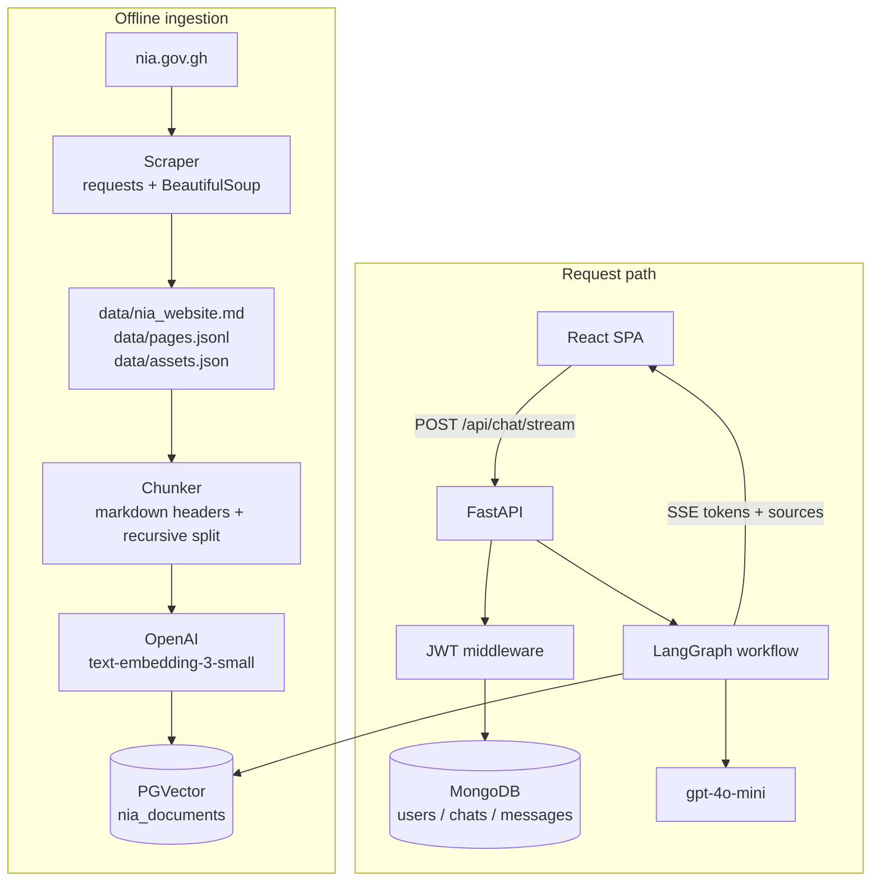
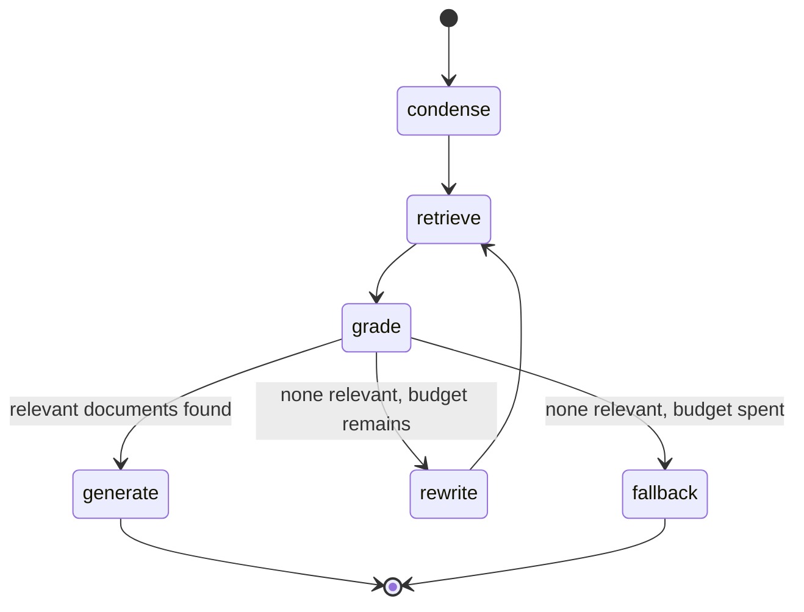

# NIA RAG System - Architecture and Design

A Retrieval-Augmented Generation system over the public website of Ghana's National
Identification Authority (<https://nia.gov.gh/>). This document explains how the pieces fit
together and, more importantly, *why* each one is built the way it is.

For setup and run instructions see [README.md](README.md).

---

## Table of contents

1. [System overview](#1-system-overview)
2. [Component architecture](#2-component-architecture)
3. [Web scraping](#3-web-scraping)
4. [Preprocessing and chunking](#4-preprocessing-and-chunking)
5. [Embeddings and the vector store](#5-embeddings-and-the-vector-store)
6. [The LangGraph RAG workflow](#6-the-langgraph-rag-workflow)
7. [Backend API](#7-backend-api)
8. [Data models](#8-data-models)
9. [Frontend](#9-frontend)
10. [Containerisation and deployment](#10-containerisation-and-deployment)
11. [Security model](#11-security-model)
12. [Observability and failure handling](#12-observability-and-failure-handling)
13. [Design decisions and trade-offs](#13-design-decisions-and-trade-offs)
14. [Known limitations and future work](#14-known-limitations-and-future-work)

---

## 1. System overview

The system has two halves that meet at the vector store.

The **offline half** scrapes nia.gov.gh into a markdown corpus, splits it into chunks, embeds
those chunks with OpenAI, and writes them to PGVector. It runs on demand, not per request.

The **online half** takes a user's question, retrieves the chunks most likely to answer it,
filters them for actual relevance, and asks an LLM to compose an answer grounded in what
survived — citing its sources and declining when the corpus has nothing to offer.



### Technology choices

| Layer | Technology | Why |
| --- | --- | --- |
| Scraping | `requests` + `BeautifulSoup` + `lxml` | Site is server-rendered; no browser automation needed |
| Orchestration | LangGraph | Retrieval needs conditional branching and a retry loop, which a linear chain cannot express |
| LLM framework | LangChain | Standard interfaces for prompts, structured output and vector stores |
| Vector store | PGVector on Postgres 16 | Vectors sit beside relational metadata; one database to operate |
| Embeddings | `text-embedding-3-small` | 1536 dimensions, strong quality per cent at this corpus size |
| Generation | `gpt-4o-mini` | Fast and cheap; the task is extraction and summarisation, not reasoning |
| API | FastAPI | Async, native SSE streaming, automatic OpenAPI docs |
| User data | MongoDB | Schema-flexible documents for users, conversations and message history |
| Frontend | React 18 + Vite + TypeScript + Tailwind | Fast builds, type safety across the API boundary |
| Packaging | Docker Compose | Five services with health-gated startup ordering |

---

## 2. Component architecture

```
lesson21/
├── scraper/                  Standalone; no database or API key required
│   ├── config.py             URLs, politeness, CSS selectors
│   ├── crawler.py            Sitemap discovery, retries, caching, robots.txt
│   ├── parser.py             HTML → markdown, metadata and asset extraction
│   ├── cleaner.py            Cross-page boilerplate removal
│   ├── office_locations.py   Store-locator API extraction
│   ├── exporters.py          Markdown / JSONL / asset manifest writers
│   └── run_scrape.py         CLI entry point
├── backend/app/
│   ├── config.py             Pydantic settings from the environment
│   ├── main.py               App factory, CORS, exception handlers, lifespan
│   ├── deps.py               get_db, get_current_user
│   ├── api/routes/           auth, chat, history, health
│   ├── auth/                 bcrypt hashing, JWT, user persistence
│   ├── db/                   Mongo client, PGVector client
│   ├── ingest/               Chunking and the embedding job
│   ├── rag/                  Prompts, retriever, LangGraph workflow
│   └── services/             Conversation and message persistence
└── frontend/src/
    ├── api/client.ts         axios instance, SSE reader, error normalisation
    ├── context/AuthContext   Session state and restoration
    ├── components/           ChatMessage, ChatInput, Sidebar, SourcesPanel
    └── pages/                Login, Register, Chat
```

The scraper is deliberately decoupled from the backend: it imports nothing from `app/` and
can run with three dependencies and no credentials. The backend image copies it in so the
ingest job can refresh the corpus from the same container.

---

## 3. Web scraping

### Discovery

The site publishes a Rank Math sitemap index at `/sitemap_index.xml` which fans out to five
child sitemaps. These are the authoritative list of public URLs:

| Child sitemap | URLs | Mapped content type |
| --- | --- | --- |
| `post-sitemap.xml` | 102 | `news` |
| `page-sitemap.xml` | 41 | `page` |
| `service-sitemap.xml` | 7 | `service` |
| `category-sitemap.xml` | 6 | `category` |
| `office-locations-sitemap.xml` | 307 | `office_location` |

A breadth-first link crawl follows, seeded from the sitemap results, capped by
`max_crawl_depth` and `max_pages`. It exists to catch pages the sitemap omits; in practice it
adds around 14. Sitemap-first ordering matters because it gives every page a meaningful
content type before any HTML is parsed, and that type propagates all the way into chunk
metadata.

### Politeness

- `robots.txt` is parsed with `urllib.robotparser` and consulted before every fetch.
- Requests are throttled to roughly one per second.
- Retries use exponential backoff on 429 and 5xx only, capped at three attempts.
- A descriptive User-Agent identifies the crawler.
- Responses are cached to `data/cache/` keyed by URL hash, so iterating on the parser costs
  the site nothing.

### Content extraction

The site is built with Elementor, which emits deeply nested `div` soup with no `<main>` or
`<article>` landmarks and no `<footer>` element. Two observations make extraction reliable:

**Finding the content root.** WordPress stamps the current object's ID onto `<body>` as
`page-id-6445` or `postid-1234`, and Elementor stamps the same ID onto the matching content
wrapper as `data-elementor-id="6445"`. Pairing the two selects the page's own content exactly:

```python
match = re.search(r"\b(?:page-id|postid|post-id)-(\d+)\b", body_classes)
root = soup.select_one(f'div.elementor[data-elementor-id="{match.group(1)}"]')
```

This matters more than it first appears. The shared header template carries ~716 characters
and the footer ~733, while a sparse page like `/audio-bites/` has only 11 characters of its
own. A "largest container wins" heuristic picks the footer on every thin page — which is
exactly what happened before this rule was introduced, contaminating 131 pages with footer
text.

**HTML to markdown.** A small recursive renderer walks the content root and emits markdown
rather than calling `get_text()`. It preserves headings, nested lists, tables, links, images,
emphasis and blockquotes. Structure is worth keeping because the downstream splitter uses
headings to decide chunk boundaries, and because the fees page is a 60-row table whose meaning
collapses entirely into noise without column structure.

Comments, CDATA and doctype nodes are filtered explicitly: they subclass `NavigableString` in
BeautifulSoup, so a naive isinstance check leaks Elementor's editor annotations
("Title style five") into the output.

### Boilerplate removal

Selector-based stripping removes the obvious chrome. What survives is handled statistically:
a line appearing on more than 60% of pages is navigation, not information, and is dropped.

Synthesised content types are exempt from this analysis. Office records are built from
structured API data and contain no site chrome by construction, while their repetition is
*meaningful* — all 307 offices genuinely share the same opening hours, so frequency analysis
would strip precisely the facts worth keeping. An earlier version did exactly that.

A safety net restores the original text if filtering would reduce a page below 20 words.

### Office locations: a special case

The 307 `/office-locations/<slug>/` pages render nothing useful server-side. Their addresses
are injected at runtime by the Agile Store Locator plugin, so the HTML contains only a page
title. Scraping them yields 307 near-empty documents.

The plugin sources its data from `/wp-admin/admin-ajax.php` — a path `robots.txt` *explicitly
allows* (`Allow: /wp-admin/admin-ajax.php`) — which returns the complete structured record for
every office: region, Ghana Post GPS digital address, phone, coordinates and opening hours.
The scraper calls that endpoint once instead of making 307 pointless requests.

Each record is rendered to markdown with a natural-language lead sentence before the
structured fields:

> The National Identification Authority (NIA) office for Ablekuma Central is located in the
> Greater Accra Region of Ghana. Its Ghana Post GPS digital address is GA-316-4716.

The lead sentence is not decoration. Embedding similarity is computed against the chunk text,
and a user asking "where is the NIA office in Ablekuma Central" matches prose far better than
it matches a bullet list of field-value pairs. Source values are also title-cased, since the
API returns `ALL CAPS` which embeds slightly worse and reads badly in citations.

### Output

| File | Purpose |
| --- | --- |
| `data/nia_website.md` | Human-readable corpus: metadata preamble, table of contents, one `##` section per page |
| `data/pages.jsonl` | One JSON record per page; the ingestion job's input |
| `data/assets.json` | Every image, PDF, media file and external link, with the pages citing each |

Current corpus: **468 pages, ~105,600 words, 1.0 MB of markdown**, plus 127 images,
23 documents and 33 external links.

---

## 4. Preprocessing and chunking

### On normalisation

The original brief called for lowercasing text and stripping punctuation. **This system
deliberately does neither.**

Those steps belong to the bag-of-words era, where they reduced vocabulary sparsity for TF-IDF
and similar lexical models. Transformer embedding models are trained on natural text, and
casing and punctuation carry signal they rely on: `GH¢200.00` and `gh200` are not the same
token, "Act 707" loses its reference without capitalisation, and sentence boundaries guide
attention. Normalising them away measurably degrades retrieval.

Cleaning is therefore limited to what genuinely removes noise:

- Unicode NFKC normalisation, so visually identical characters compare equal
- Non-breaking spaces and zero-width characters removed
- Words rejoined across hyphenated line breaks
- Runs of whitespace collapsed; blank lines preserved because they delimit markdown blocks

### Splitting strategy

Two strategies run side by side, selected by content type.

**Ordinary pages** are split by `MarkdownHeaderTextSplitter` on `#`, `##` and `###` first, so
each chunk inherits its section, then packed by `RecursiveCharacterTextSplitter` to 1000
characters with 150 characters of overlap. Headers are retained in the text. The separator
order (`\n\n`, `\n`, `. `, ` `) prefers breaking at paragraph boundaries and only falls back to
mid-sentence breaks when a passage leaves no choice.

**Office locations** are not split at all. Each of the 307 is a single chunk. They are short
and structurally identical, so splitting would produce fragments that are nearly
indistinguishable in embedding space — a query about one constituency would retrieve halves of
three different offices and the generator would blend them into a plausible, wrong answer.
One record per chunk makes a location answer atomic and verifiable.

### Tables are split on their own terms

Character-based splitting destroys tables, and the fees page is a 60-row table carrying the
most frequently asked facts on the site. Splitting it by character count produced chunks
beginning mid-table with bare cells like `| 2.3 | Card Replacement within the ECOWAS
Sub-Region | ...` — no column names, no indication which fee category the row belonged to.

Tables are therefore detected and routed through a dedicated splitter that:

1. breaks only on row boundaries, never mid-row;
2. repeats the header and separator rows in every piece, so each one is self-describing;
3. starts a new chunk at each in-table group heading (`| ##### 2. Card Replacement Service |`),
   because a fee category is the unit questions are actually about;
4. carries the current group heading into continuation chunks when a category overflows.

The effect is measurable. Asking "How much does it cost to replace a Ghana Card?" previously
returned the Premium Centre, ECOWAS and overseas prices but silently omitted **GHc200.00 at an
NIA District Office** — the common case, and the single most likely thing a user wants. That
row sat in a chunk dominated by first-time-registration rows, so it ranked too low to be
retrieved. With category-aligned chunking the whole replacement table arrives as one coherent
chunk and the answer is complete.

### Contextualisation

Every chunk is prefixed with its page title and section:

```
# NIA Approved Fees and Charges - Card Replacement Service

| 2.1 | Card Replacement at NIA District Office | GHc200.00 |
```

Retrieval matches the embedding of the chunk alone, so a passage lifted from the middle of a
page must carry enough context to be findable and to read sensibly in the prompt.

### Resulting distribution

| Content type | Chunks |
| --- | --- |
| News | 768 |
| Office locations | 307 |
| Pages | 189 |
| Discovered pages | 100 |
| Services | 47 |
| Categories | 12 |
| **Total** | **1,423** |

Chunk sizes: minimum 105, median 720, maximum 1,105 characters.

---

## 5. Embeddings and the vector store

Embeddings use `text-embedding-3-small` (1536 dimensions) in batches of 256. Embedding the
full corpus costs roughly one US cent.

PGVector stores them in the `nia_documents` collection with `use_jsonb=True` so metadata is
queryable, using cosine distance.

### Idempotent ingestion

Each chunk's primary key is `sha256(source_url + chunk_text)`. Re-running ingestion overwrites
unchanged chunks in place rather than accumulating duplicates, so the job is safe to repeat
and only genuinely changed content produces new rows. `--reset` drops the collection first
when the chunking strategy itself changes.

### Metadata

| Field | Use |
| --- | --- |
| `source_url` | Citation link shown in the UI |
| `title` | Citation label |
| `content_type` | Optional retrieval filter; also drives UI labelling |
| `section` | Which part of the page the chunk came from |
| `chunk_index` | Ordering within a page |
| `scraped_at`, `published`, `lastmod` | Freshness |
| `content_hash` | Idempotency key |

A distance ceiling of 0.75 discards weak matches before they reach the grader, so an unrelated
question retrieves nothing rather than the six least-unrelated chunks in the corpus.

---

## 6. The LangGraph RAG workflow

A linear retrieve-then-generate chain has a failure mode worth designing around: when
retrieval returns nothing relevant, the generator still produces something. The workflow is a
state machine specifically so it can detect that case and respond differently.



### Nodes

**`condense`** rewrites a follow-up into a standalone question using the conversation history.
"How much is that?" after a question about card replacement retrieves nothing on its own;
resolved against context it becomes answerable. Skipped entirely on the first turn.

**`retrieve`** runs cosine similarity search for the top `k` (default 6) chunks above the
distance threshold. PGVector's client is synchronous, so the call is dispatched with
`asyncio.to_thread` to keep the event loop free.

**`grade`** asks the LLM, in a single structured-output call, which retrieved chunks could
contribute to an answer. One call grades all six rather than six parallel calls — same signal,
a sixth of the latency and cost. The prompt deliberately errs toward inclusion: excluding a
partially relevant chunk is more damaging than including a marginal one. If grading fails for
any reason the node degrades to trusting retrieval rather than returning silence.

**`rewrite`** translates the query into official NIA vocabulary ("ID card" becomes "Ghana
Card", "office" becomes "registration centre") and loops back to retrieval. Budgeted by
`MAX_QUERY_REWRITES`, default 1, so the graph cannot cycle indefinitely.

**`generate`** composes the answer from the numbered context. The prompt forbids unsourced
claims, requires inline `[1]`-style citations, and mandates exact quotation of amounts, dates
and contact details. This model is tagged `final_answer` so the SSE layer can isolate its
tokens from the auxiliary condense, grade and rewrite calls, which must not leak into the
user's stream.

**`fallback`** returns a fixed message pointing at nia.gov.gh and the NIA phone number. For a
government information service, admitting ignorance is strictly better than a confident
fabrication about fees or legal requirements.

### Streaming

`astream_events(version="v2")` drives the SSE endpoint, emitting three event kinds: `status`
when a node starts (so the UI can show "Searching the NIA website…"), `token` for each piece of
the answer, and a final `done` carrying the complete text, the deduplicated sources and a
`grounded` flag. The fallback path never invokes the streaming model, so its text is emitted
as a single synthetic token event to keep client rendering uniform.

---

## 7. Backend API

All routes are prefixed `/api`. Everything except `/health`, `/auth/register` and
`/auth/login` requires `Authorization: Bearer <token>`.

| Method | Path | Request | Response | Codes |
| --- | --- | --- | --- | --- |
| `GET` | `/health` | - | `HealthResponse` | 200 |
| `POST` | `/auth/register` | `UserCreate` | `Token` | 201, 409, 422 |
| `POST` | `/auth/login` | `UserLogin` | `Token` | 200, 401, 422 |
| `GET` | `/auth/me` | - | `UserPublic` | 200, 401 |
| `POST` | `/chat` | `ChatRequest` | `ChatResponse` | 200, 401, 422, 502, 503 |
| `POST` | `/chat/stream` | `ChatRequest` | `text/event-stream` | 200, 401, 422 |
| `GET` | `/chats` | `?limit` | `ChatSummary[]` | 200, 401 |
| `GET` | `/chats/{id}` | - | `ChatDetail` | 200, 401, 404 |
| `DELETE` | `/chats/{id}` | - | empty | 204, 401, 404 |

### Request flow for a question

1. Validate the bearer token and load the user.
2. Resolve the conversation: use `chat_id` when it exists and belongs to the caller, otherwise
   start a new one. An unknown or foreign ID silently starts a new conversation rather than
   erroring, so a stale browser tab cannot wedge the client.
3. Load the last six turns as history.
4. Persist the user's message.
5. Run the graph.
6. Persist the assistant's message with its sources — for the streaming endpoint, only after
   the stream completes, so an aborted request leaves no truncated answer in history.

### Error handling

A `RequestValidationError` handler flattens Pydantic's nested error list into one readable
sentence, because the raw structure is unhelpful in a UI. A catch-all handler logs the
traceback and returns a generic 500 without leaking internals.

RAG failures are split by cause rather than lumped together. Retrieval that *cannot run* —
an unreachable vector store or a rejected API key — returns 503 naming the likely fix, while
retrieval that runs and finds nothing returns 200 with the honest fallback message. The
distinction matters: without it, a misconfigured `OPENAI_API_KEY` presents as a chatbot
cheerfully claiming the NIA website has no information about the Ghana Card, which is a
genuinely misleading symptom to debug.

---

## 8. Data models

### MongoDB

```
users
  _id            ObjectId
  email          string      (unique index, lowercased)
  password_hash  string      (bcrypt)
  full_name      string | null
  created_at     datetime
  updated_at     datetime

chats
  _id            ObjectId
  user_id        string      (index with updated_at, descending)
  title          string      (first question, truncated to 70 chars)
  message_count  int
  created_at     datetime
  updated_at     datetime

messages
  _id            ObjectId
  chat_id        ObjectId    (index with created_at, ascending)
  user_id        string      (index with created_at, descending)
  role           "user" | "assistant"
  content        string
  sources        Source[]    (embedded, not referenced)
  created_at     datetime
```

Sources are embedded in the message rather than normalised into their own collection. They are
a point-in-time record of what the answer was based on: if the site is re-scraped and chunks
change, a past answer's citations should still reflect what it actually used.

### Postgres

Managed by `langchain_postgres`:

- `langchain_pg_collection` — one row per collection
- `langchain_pg_embedding` — `id` (our content hash), `embedding vector(1536)`,
  `document` (chunk text), `cmetadata` (JSONB)

---

## 9. Frontend

React 18 with Vite, TypeScript in strict mode, and Tailwind. Three routes: `/login`,
`/register` and `/` (chat, auth-guarded).

**Session handling.** The token is held in `localStorage` and attached by an axios request
interceptor. On mount, `AuthContext` validates any stored token against `/auth/me` before
trusting it, and the protected route holds rendering until that check resolves — otherwise a
page refresh briefly bounces an authenticated user to the login screen. A response interceptor
clears the session on any 401.

**Streaming.** `EventSource` only speaks GET and cannot set an `Authorization` header, so the
SSE stream is read manually from a `fetch` POST via `ReadableStream`. The reader buffers across
chunk boundaries and only parses complete `\n\n`-delimited frames, since a network chunk can
split a frame anywhere. A malformed frame is skipped rather than tearing down the stream.

**Rendering.** Answers are markdown, rendered with `react-markdown` and `remark-gfm` so tables
and lists survive. A blinking cursor marks the in-flight message; the sources panel appears
only once streaming finishes.

**Accessibility.** The message list is an ARIA live region so screen readers announce
streamed answers. All controls are labelled, the delete button stays reachable by keyboard
rather than appearing on hover alone, errors use `role="alert"`, and focus rings are visible
throughout. Layout is responsive, with the sidebar collapsing to an overlay below `md`.

---

## 10. Containerisation and deployment

| Service | Image | Port | Notes |
| --- | --- | --- | --- |
| `postgres` | `pgvector/pgvector:pg16` | 5432 | Named volume, `pg_isready` healthcheck |
| `mongo` | `mongo:7` | 27017 | Named volume, `ping` healthcheck |
| `backend` | built from `backend/Dockerfile` | 8000 | Waits for both databases to be healthy |
| `frontend` | nginx serving the Vite build | 5173→80 | Proxies `/api` to the backend |
| `ingest` | same image as backend | - | Profile-gated one-shot job |

The backend starts only once both databases report healthy, rather than merely started, which
removes the usual race where the API's first connection attempt fails.

The ingest job shares the backend image so the scraper and embedder are version-locked
together. It is gated behind a Compose profile because it costs money and takes minutes — it
should never run implicitly on `docker compose up`. Its entrypoint reuses an existing corpus
when one is present and only re-scrapes when asked, so re-embedding does not mean re-crawling.

The nginx config disables `proxy_buffering` on `/api/`, and the backend sets
`X-Accel-Buffering: no`. Without both, SSE tokens accumulate in a buffer and arrive in one
burst, which defeats the purpose of streaming.

Both application images run as a non-root user and declare healthchecks.

---

## 11. Security model

**Passwords** are hashed with bcrypt (cost 12 default) via the `bcrypt` library directly rather
than through passlib, whose 1.7.x backend inspection breaks against bcrypt 4.x. Because bcrypt
silently truncates input beyond 72 bytes — which would let two different long passwords
authenticate the same account — passwords longer than that are rejected at validation rather
than quietly accepted.

**Login timing.** When an email is not found, the code still performs a bcrypt comparison
against a dummy hash, so a missing account and a wrong password take comparable time and the
endpoint does not leak which addresses are registered.

**Tokens** are HS256 JWTs carrying `sub`, `iat` and `exp`, signed with `JWT_SECRET` and valid
for 24 hours by default.

**Authorisation** is enforced per resource, not merely per route: every chat and message query
filters on `user_id`, so a valid token for user A cannot read user B's conversation by
guessing an ID.

**Input validation** is handled by Pydantic v2 at the boundary — questions are capped at 2000
characters, emails validated, passwords length-checked.

**Known trade-offs for this educational build:** `localStorage` is vulnerable to XSS (an
httpOnly refresh-token cookie would be the production choice); there are no refresh tokens or
revocation list, so logout is client-side only; there is no rate limiting, which a public
deployment would need in front of a paid LLM API; and `.env` holds secrets in plaintext, where
production would use a secrets manager.

---

## 12. Observability and failure handling

Structured logging runs throughout with module-level loggers. The `/api/health` endpoint
reports both database connections and the current embedded chunk count — a count of zero is
the single most common cause of "the assistant doesn't know anything", so surfacing it turns a
confusing symptom into an obvious diagnosis.

Every external dependency has a defined degradation path:

| Failure | Behaviour |
| --- | --- |
| Page fetch fails | Logged, skipped, crawl continues |
| Sitemap unavailable | Falls back to link-following crawl |
| Store locator API fails | Logged; the rest of the corpus still builds |
| Document grading fails | Degrades to trusting retrieval rather than returning nothing |
| Query rewrite fails | Reuses the original query |
| Retrieval returns nothing | Rewrite once, then an honest fallback message |
| Retrieval cannot run at all | 503 naming the likely cause (empty store or bad API key) |
| Generation fails | 502 with a retry-oriented message |
| MongoDB down at startup | API still serves `/health` for diagnosis |
| Malformed SSE frame | Skipped; the stream continues |

---

## 13. Design decisions and trade-offs

**Sitemap-first discovery over pure link crawling.** Deterministic, complete, and it assigns a
content type to every URL before parsing. The link crawl remains as a safety net.

**One markdown corpus file plus JSONL.** The markdown file is the human-reviewable artefact —
you can read it and judge extraction quality directly. The JSONL is what the machine consumes.
Keeping both costs little and makes the pipeline debuggable.

**Office locations from the AJAX endpoint.** Fewer requests, structurally richer data, and the
alternative produces nothing usable. The endpoint is explicitly permitted by `robots.txt`.

**Document grading despite the added latency.** One extra LLM call per question buys a
meaningful reduction in confident-but-wrong answers, because semantic similarity alone happily
returns the nearest chunk even when nothing in the corpus is actually relevant.

**Atomic office chunks.** Prevents the blending failure mode where an answer is assembled from
three different offices' fragments.

**Table-aware, category-aligned chunking.** Tables carry the highest-value facts on this site
and are precisely what naive character splitting mangles.

**Settings are frozen.** `@lru_cache` requires hashable arguments, and a mutable Pydantic model
is not hashable. Freezing the settings object is what makes the cached embedding, LLM and
vector-store accessors work at all; without it every call raised `TypeError: unhashable type`,
which the retrieval layer caught and reported as an unreachable knowledge base.

**Preserving case and punctuation.** Discussed in §4; the single highest-impact decision for
retrieval quality in this pipeline.

**Content hash as primary key.** Makes re-ingestion idempotent without a separate diffing step.

**Streaming via fetch rather than EventSource.** Required to send an `Authorization` header.

**Embedding sources in messages.** Citations stay accurate for past answers even after the
corpus is re-scraped.

---

## 14. Known limitations and future work

- **Static snapshot.** The corpus reflects the last scrape. A scheduled re-run with change
  detection on `lastmod` would keep it current cheaply.
- **PDFs are catalogued but not read.** 23 linked documents, including the official fees
  schedule, are recorded in `assets.json` but not parsed. Extracting their text would add
  authoritative content the HTML pages only summarise.
- **Dense retrieval only.** Hybrid search combining BM25 with vectors would handle exact-token
  queries (specific L.I. numbers, phone numbers) better than embeddings alone.
- **No reranking.** A cross-encoder over the top 20 would likely beat the current
  grade-and-filter step on precision, at some latency cost.
- **English only.** Ghana has many widely spoken languages; multilingual embeddings and
  prompts would widen reach considerably.
- **No evaluation harness.** A labelled question set scored for retrieval recall and answer
  faithfulness would make changes to chunking or prompts measurable rather than anecdotal.
- **Single-node deployment.** Horizontal scaling would need connection pooling, a shared cache
  and sticky-free session handling.

---

*Educational project. Not affiliated with or endorsed by the National Identification Authority.
Always confirm official information at <https://nia.gov.gh/>.*
